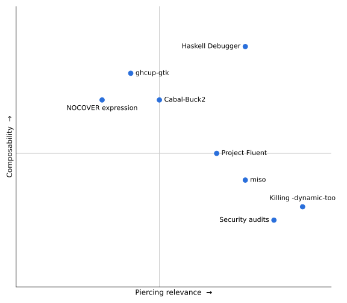

Vision Manifesto
================

I've been thinking about what I consider to be a good project, and especially
what makes a project worth spending money when the goal is to improve the language/ecosystem/adoption.

I have found there are 2 axis which are fundamental to my reasoning about this for all projects:

- Piercing relevance (as opposed to superficiality)
- Composability (as opposed to developed in isolation without regard for existing tools)

And there is at least a 3rd axis for outside-of-work projects:

- Fun and/or niche

I want to focus on the two first ones, as they should strongly factor into my
decisions in the TLC:

## Piercing Relevance

This axis judges how impactful and how relevant a given project is to the
community, ecosystem and language at large. A few criteria:

- It's really important (even if not very attractive)
- Benefits a lot of people
- It is exciting to lots of people, and/or very attractive
- It displays Haskell's unique strenghts in a way that makes even
  non-Haskellers be curious and hungry for more
- Does it improve significantly (eg. performance) existing tools or libraries=
- It is incremental progress to something really relevant
- It addresses an important ecosystem gap that forces people to use other
  languages
- Can it be done by existing tools vs is it fundamentally new and necessary?

## Composability

How much does the project leverage existing ecosystem libraries and tools (as
opposed as to re-inventing everything from scratch) and how well do we imagine
this tool or library will integrate with, and unlock/unblock, future work that
should rely on it.

- Does it follow UNIX principles?
- Will it fit in nicely and do its own part, without stepping on the other
  parts, with the already existing user workflows?
- Is it standalone and one-shot and requires its own setup and re-learning
  things from scratch?
- Or can a Haskell user easily pick it up because it already fits in with the
  tooling and libraries they use?
- Is it a replacement or competing standard for existing tools or libraries
  rather than finding key ways to make the upstream project better
- How well can an AI also leverage this tool or library, (assuming that we
  develop for humans, as developing for AIs is a moving target with arguably
  awful returns)?
    - Here I'd favour good CLI or scripting interfaces that the AI can directly
      use as opposed to custom MCPs that have a costly setup and are AI-only-usable.
- Does it improve existing already composable tools and make them more useful and/or fast
- Does it use hie-bios?
- Does it compose?

Something along those lines...

## Examples

I think both of these are hard to define objectively, but one thing we can do
with two axis is plot examples!

Here is my subjective view of recent projects. Let me know if you'd like to me
to expand on the placement of any of these.

I'm going to leave out projects which would succeed in the Fun/niche axis (like
WaterfallCAD, apecs-things, ...)

 

## Conclusion

I think these are two very important axis in which we should consider each
project to fund. I am also aware they are weird axis in that sometimes they
overlap, and sometimes they are not sufficient to cover why a project is still
worth funding.

It is an imperfect set of criteria. They mostly try to reflect what goes often
into my decision process -- not what should be decision process.

